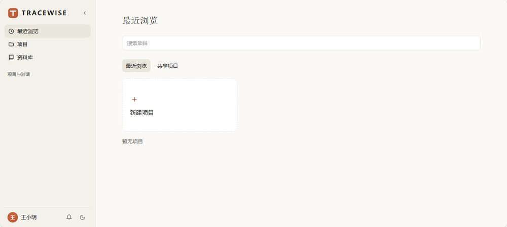
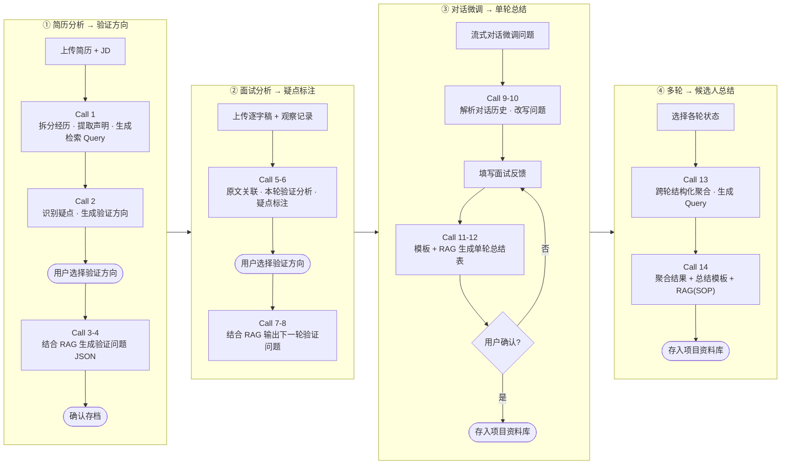
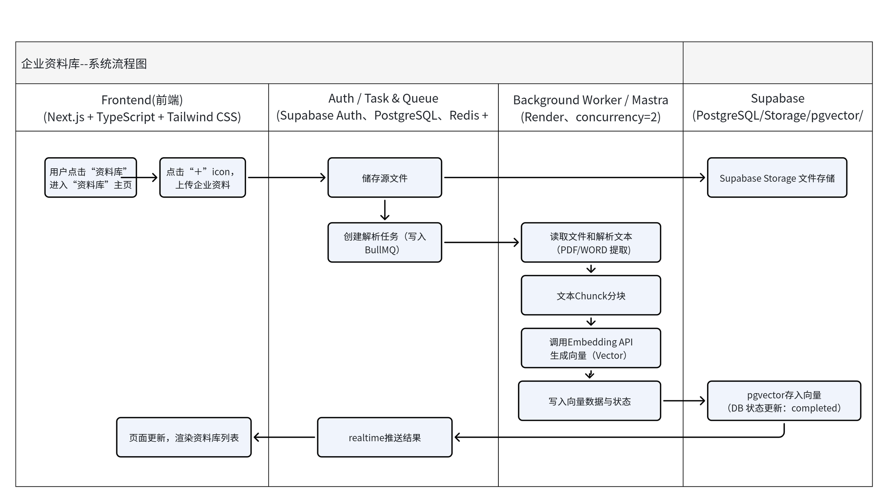

# Tracewise · 候选人经验验证协同 Agent

> 面向招聘团队的多轮候选人核验 Agent：围绕简历声明逐轮提取疑点、承接验证，区分「已确认事实 / 证据不足 / 面试官判断」，每条结论可溯源到简历与逐字稿原文。

**在线体验：** https://tracewise.ganzee.top ｜ **角色：** 产品设计 + 独立开发 ｜ **技术：** Next.js · React · Mastra Workflow · BullMQ/Redis · Supabase · DeepSeek · RAG



## 01 为什么做
- **HM** 承担用人与管理成本，招错要重招；**HR** 承担大量重复的筛选与记录；**老板** 承担机会成本。
- 现有流程的断点：HR 与 HM 对需求理解有偏差；各轮面试官互不知道前面问了什么，问题重复、反馈偏主观；简历经历是否真实缺少验证手段。

## 02 产品定位
让面试中的信息**连续沉淀、递进验证**，形成可追溯的判断依据，最终帮助决策者比较候选人。

**非目标：** 不做 ATS、不做招聘网站、不自动做录用决策、不把候选人量化成一个分数。

**差异化：** Greenhouse / Moka 偏流程管理与结构化面试，BrightHire / Metaview 偏面试记录沉淀与欺诈检测；「候选人经历真实性的跨轮次验证衔接」是它们未覆盖的部分。

## 03 核心流程
```
简历声明 → 第一轮取证、暴露疑点 → 区分 已确认事实 / 证据不足 / 面试官判断
→ 保留所引用的简历、回答与面试记录 → 下一轮继承并继续验证 → 多轮后生成可追溯总结 → 多候选人横向对比
```
数据结构：项目 → 候选人 → 面试轮次（逐字稿、逐字稿标注、简历疑点标注、单轮结论表）。项目级上下文共享，候选人级上下文隔离。

## 04 Agent 与固定工作流的分工
**Agent 介入 6 个节点**（任务输入随候选人与轮次动态变化）：简历解析与声明提取 · 疑点提取与验证问题生成（含多轮）· 对话调整验证问题 · 单轮面试结论表 · 简历/逐字稿疑点标注 · 候选人总结。

**固定工作流：** 保存逐字稿、关联原文位置、展示与确认问题、横向对比报告。

**人机分工：** Agent 负责整理、关联、分析与辅助验证，最终判断始终由人做。

## 05 AI 推理流程与系统工作流
**AI 推理流程：** 14 次 LLM Call 分四个阶段衔接，关键节点由用户选择与确认，AI 不替代人做最终判断。



**系统工作流（企业资料库入库）：** 企业职级标准 / 业务文件 / SOP 上传后，由 BullMQ 队列异步解析、分块、向量化，状态通过 Realtime 推回前端。



> 业务主流程（用户 / 系统两条泳道，覆盖项目创建、多轮面试到候选人总结）较大，见 [docs/business-flow.md](docs/business-flow.md)。

## 06 技术架构
| 层 | 方案 |
|---|---|
| 应用 | Next.js (App Router) + React，Supabase Auth 与角色权限 |
| AI 工作流 | Mastra Workflow 编排 14 次 LLM 调用，Zod 定义并校验结构化输出；网络错误 / 429 / 5xx 指数退避重试（2s、5s） |
| 异步任务 | BullMQ + Redis 队列，长任务状态可查询 |
| 大模型 | DeepSeek（结构化输出） |
| RAG | 企业职级标准 / 业务文件 / SOP 切块 + 向量化，应用层余弦相似度检索（数据量级为百级，暂不引入 pgvector） |
| 存储 | Supabase Postgres（结构化数据）+ Storage（文件） |

详见 [docs/architecture.md](docs/architecture.md)、[docs/workflow.md](docs/workflow.md)，代码节选见 [src/README.md](src/README.md)。

## 07 假设与风险（如实标注）
- 待验证：AI 能否由简历生成有效验证任务；HM 是否愿意在面试前使用；多轮承接效果
- 技术风险：多轮上下文累积后判断是否稳定；企业文件质量参差对 RAG 的影响；评测结果的合规风险
- 接受度风险：面试官是否愿意多花时间；企业是否愿意上传内部资料

## 文档
[PRD](docs/PRD.md) · [业务主流程](docs/business-flow.md) · [架构](docs/architecture.md) · [AI 工作流](docs/workflow.md) · [风险与复盘](docs/risks-and-retrospective.md)

## 说明
本仓库为项目展示，不含密钥、真实候选人数据与完整 Prompt 原文。代码仅供展示，未经许可不得复制商用。
