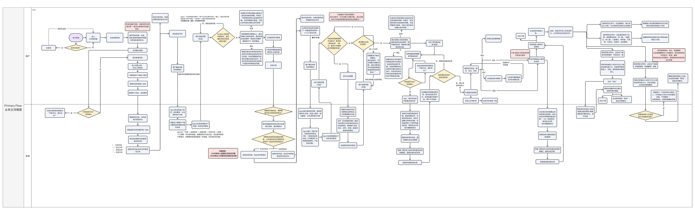

# 业务主流程图

用户 / 系统两条泳道，覆盖：创建项目与上传简历 → 疑点识别与验证方向选择 → 验证问题生成与确认 → 面试逐字稿分析与疑点标注 → 对话微调 → 单轮总结表 → 多轮聚合的候选人总结。

流程图尺寸较大，建议点击图片后放大查看。

## 相关
- AI 推理流程（14 次 LLM Call）：见 [README · 05](../README.md)，Mermaid 源文件：[ai-inference-flow.mmd](images/ai-inference-flow.mmd)；早期版本图：[ai-inference-flow-v1.png](images/ai-inference-flow-v1.png)
- 逐阶段规格：[AI 工作流](workflow.md)
