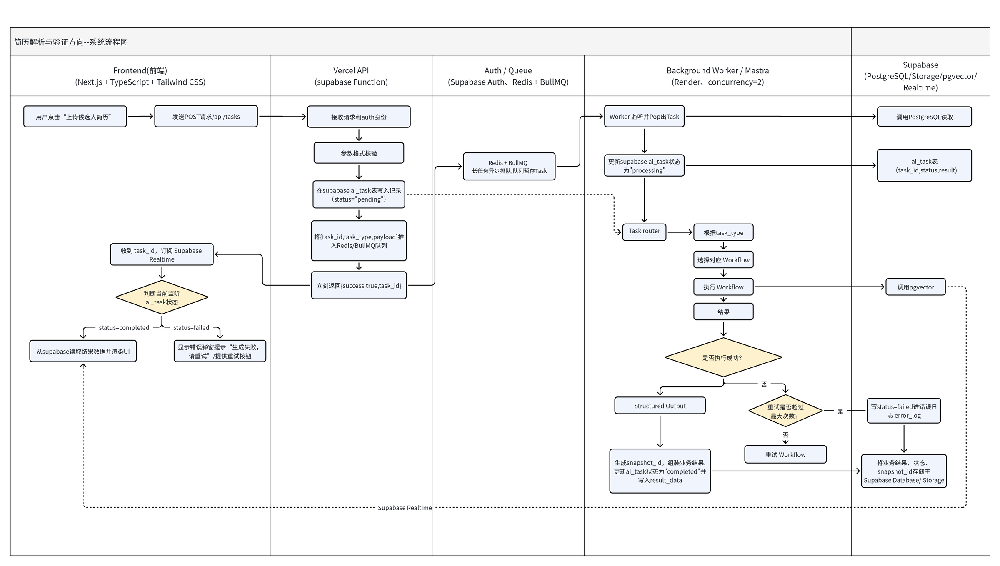
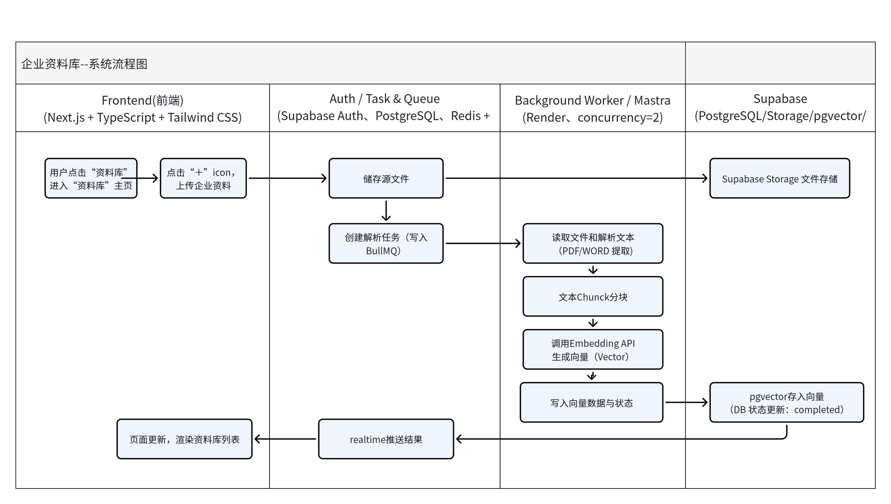
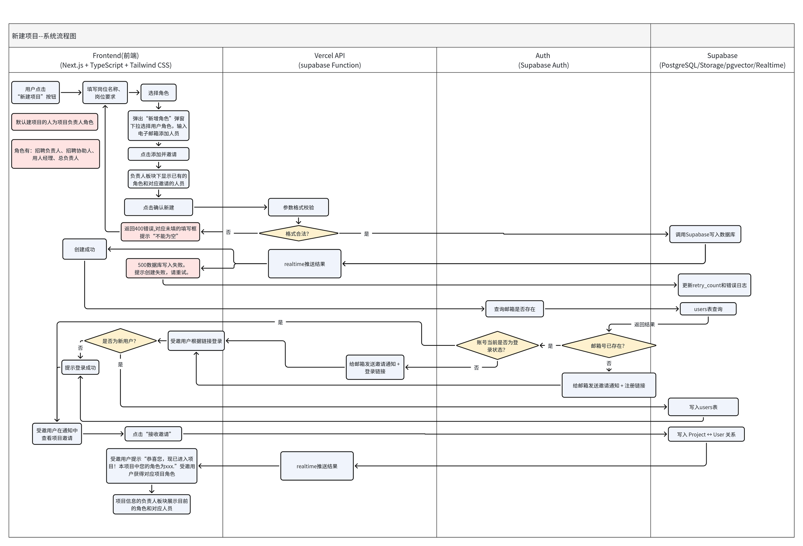
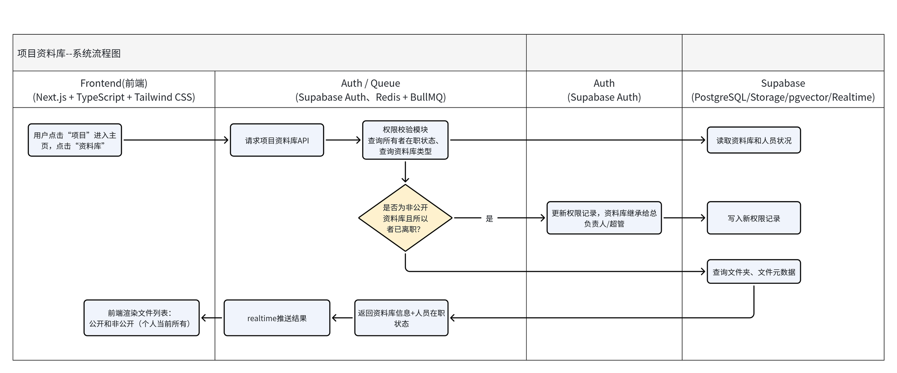
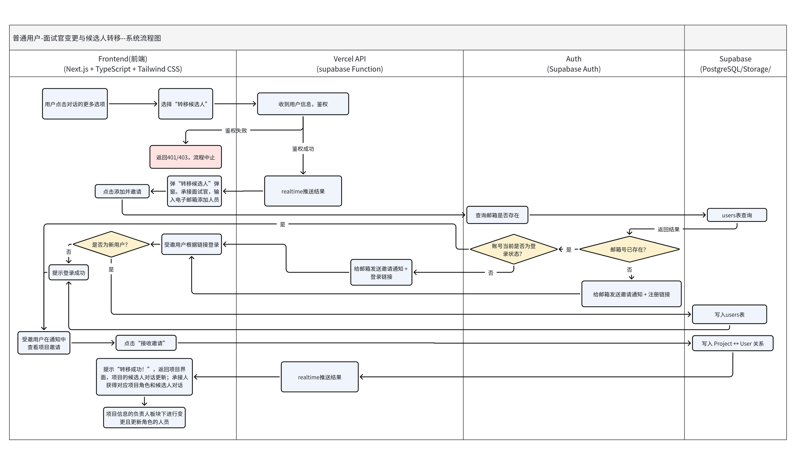
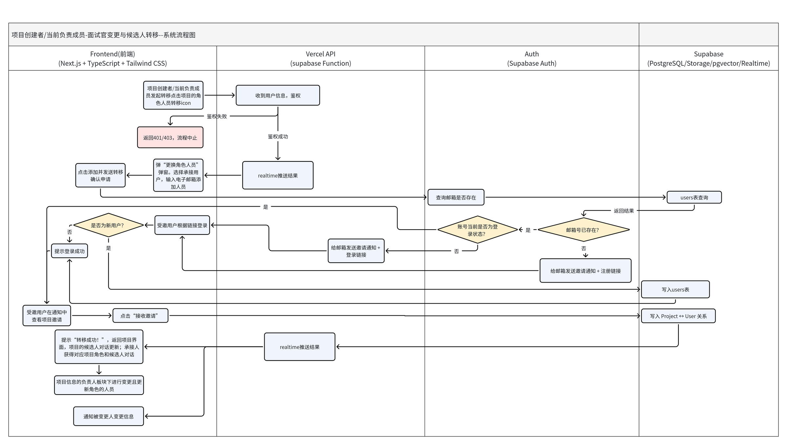
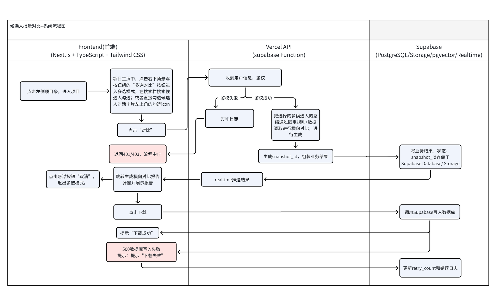
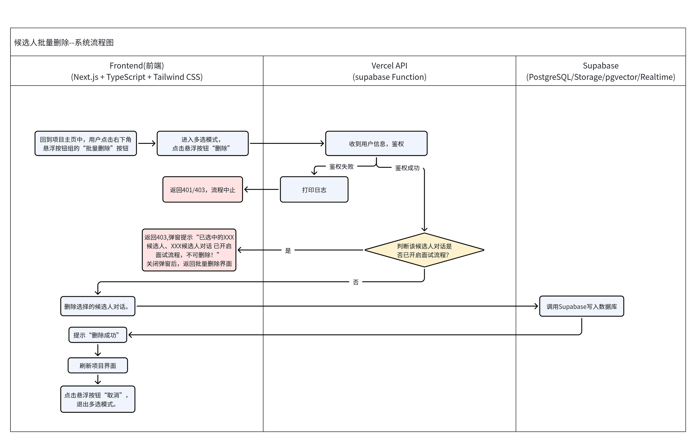
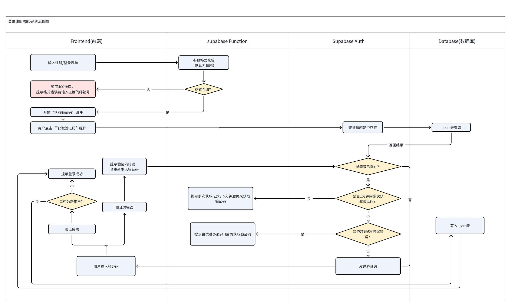

# 系统流程图

> 说明：图中 Supabase 泳道标注了 pgvector，这是设计稿写法。V1 实际实现为 embedding 存 jsonb、应用层计算余弦相似度（切块量级为百级），数据量变大后再迁移 pgvector。主链路上的泳道分工是：前端（Next.js）→ 接口层 → Auth / 队列（Supabase Auth、Redis + BullMQ）→ 后台 Worker（Mastra）→ Supabase（Postgres / Storage / Realtime）。

## 核心链路
### 简历解析与验证方向（AI 任务异步链路）
POST 创建任务 → 写 `ai_task`（pending）→ BullMQ 队列 → Worker 按 `task_type` 路由 Workflow → 重试与失败日志 → 结果落库 → Realtime 回推。

### 企业资料库（文件上传 → 解析 → 分块 → 向量化）

## 项目与权限
### 新建项目（角色邀请）

### 项目资料库（权限校验与离职继承）

### 面试官变更与候选人转移
普通用户发起（承接人确认后转移）：

项目创建者 / 当前负责成员发起：

## 候选人批量操作
### 批量对比

### 批量删除（已开启面试流程不可删）

## 账号
### 登录注册（邮箱验证码）

